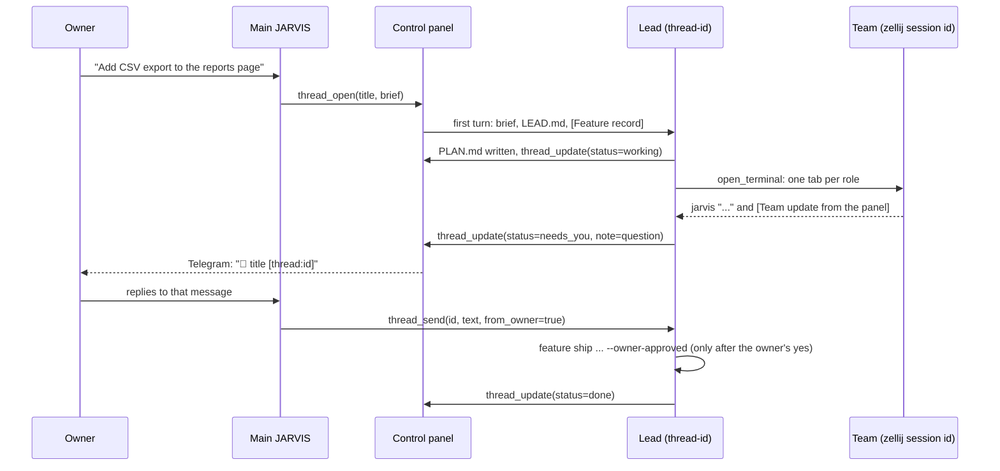

# Threads: an executive assistant and a product lead per feature

This is the framework that turns JARVIS from one chat into a small engineering organisation. It is spread over
both repos: the behaviour lives here (`hermes/SOUL.md`, `hermes/LEAD.md`, `bin/feature`, `bin/feature-doc`,
`bin/jarvis`, the MCP tools in `mcp/vm_mcp.py`), and the state, the page and the checks live in the
control panel (the `control-panel` repository: `threads.go`, `featdoc.go`, `featverify.go`, `featsup.go`,
`scout.go`, ...).

Contents: [the idea](#the-idea) · [who is who](#who-is-who) · [lifecycle](#lifecycle) ·
[what a lead sees](#what-a-lead-sees-every-turn) · [tools](#tools) · [bin/feature](#binfeature-one-branch-one-commit) ·
[the feature record](#the-feature-record) · [reporting](#how-the-team-reports) · [escalation](#reaching-the-owner) ·
[guard rails](#guard-rails) · [where to look](#where-to-look) · [limits](#limits-and-known-gaps)

## The idea

One long chat cannot hold a project. Everything the owner asks piles into it, and the assistant loses the plot.
So the work is split in two levels:

- **Main JARVIS** is the owner's executive assistant: one chat (the panel's Assistant view and the Telegram DM
  share it) that sees everything, answers quick things itself, and keeps the whole picture. Anything bigger than a
  few replies (a feature, a project) is handed to a thread.
- **A thread** is a fresh JARVIS, with the same `SOUL.md` rules and the same memory, that acts as the **product lead
  for one feature only**. It plans the feature, decides the team it needs, and runs that team of Claude Code and
  Codex agents in a **zellij session of its own**, on **one git branch** that lands on `stage` as **one squashed
  commit** once the owner says yes.

Nothing else is a unit of work: there is no task board. A thread is the unit, and the feature record (a folder of
markdown files) is the thread's plan, evidence and log.

## Who is who

| Who | What it is | How it acts |
|---|---|---|
| The owner | the one human | Telegram, or the panel (Assistant view, Terminals / feature page). Only the owner approves checks, verifies, accepts outcomes, answers questions, releases holds, says yes to shipping. |
| Main JARVIS | Hermes session `panel` (plus the Telegram DM and per-pane sessions) | `thread_open`, `thread_send`, `thread_list`; fleet tools. Does not run a feature itself. |
| A lead | Hermes session `thread-<id>`; the playbook `hermes/LEAD.md` is sent with every turn | plans, picks roles, starts agents (`open_terminal`), keeps the record, asks the owner, ships. Does not do its agents' work. |
| Team agents | Claude Code or Codex panes in zellij session `<id>` (one tab per role) | work in their own git worktree; report with `jarvis` and `feature-doc`; never merge or push to `stage`/`main`. |
| The panel | the control panel (`threads.go`, `feat*.go`) | stores threads, drives every thread turn, owns the record writer and the verification, runs the supervisor and the scout, notifies. |

## Lifecycle



### 1. Opening a thread

Three ways in, all of which end in `openThread` in the panel:

1. **The owner replies in a thread.** Every message in Main's chat has **Reply in thread**. The first message the
   owner writes creates the thread; the lead's first turn carries a `[Thread context]` block (the Main message it grew
   from and a few before it) and then `[From the owner, in the panel]`.
2. **Main opens one.** `thread_open(title, brief, repo="", team="")`. The brief must stand alone: the lead cannot
   see Main's chat. The first turn starts with `[Brief from Main JARVIS, who opened this thread]`.
3. **A takeover.** The panel's *scout* (`scout.go`) looks hourly at every zellij session that no thread owns. A
   session whose agents have done nothing for 24 h while it still holds unshipped work (changed lines, an open PR)
   is "stalled"; at most once every 12 h the panel hands Main what it knows, and Main comes to the owner with a
   ` ```proposal ` block (what it is, the plan, how it will report, the proof of done, needs, blockers). The panel
   draws it as a card: **Take it over / Not now / Never**. On Approved the panel has already opened the thread
   that adopts that session (`team=<session>`); "Not now" snoozes it for 24 h. Main saves what it learns from the
   answers (see the *Being proactive* paragraph of `hermes/SOUL.md`).

A thread's `id` is a slug of its title (first five words, at most 32 characters, unique among all threads including
archived ones). `team` defaults to the id: the zellij session is named after the thread. Statuses are exactly
`planning`, `working`, `needs_you`, `done`, `archived`.

A terminal the owner runs alone stays theirs: nobody opens a thread on it or takes it over unasked. If the owner
asks in words, `thread_open(..., team=<exact session name>)` (or, from the lead, `thread_update(id, team=...)`) adopts it:
its agents become the team and its record stays where it is. One thread per session; names are matched
exactly, never guessed. (`thread_update(team=)` also requires the session to be live right now;
`thread_open(team=)` may name one the lead will start.)

### 2. Planning (status `planning`)

The lead (see `hermes/LEAD.md`, section 1):

- works out what the owner wants and why; if only the owner can answer something that changes what gets built, it
  asks in one message, sets `needs_you`, and stops until the answer comes;
- finds the repo (under `~/repos` or `~/projects`) and reads enough to plan for real;
- writes the plan into the feature record's `PLAN.md` through the panel (never by editing the files): the goal, what
  done means (checkable), the approach, then milestones and steps (format below). It proposes a `check:` command for
  every step that needs proof; **only the owner approves a check**, with Approve on the feature page;
- decides the team: roles (researcher, planner, implementer, tester, deployer ... only the ones the work needs), how many
  agents, Claude or Codex for each. Each Claude role is told to use named skills of the `agent-skills` plugin
  (e.g. `spec-driven-development`, `test-driven-development`, `code-review-and-quality`);
- saves its record: `thread_update(id, status="working", repo=..., branch="feature/<id>", note=...)` and a short
  title.

Once the owner agrees to the plan, the panel shows PLAN.md's steps on the thread with their progress.
`thread_update(plan=...)` only moves the boxes of steps PLAN.md already has, with the step's words
verbatim (`- [~] <step>`); a line that matches no step is refused. Adding or rewording steps is a
`feature_doc_write` (tell the owner why first: a reworded step or changed check needs approval again).

### 3. Running the team (status `working`)

1. `feature start <repo> <id> <role>...` creates `feature/<id>` and the worktrees (next section).
2. The lead starts the first agent with `open_terminal(what="session", name="<id>", cwd=<its worktree>, run="claude",
   prompt=...)`, then one tab per role (`what="tab", session="<id>", name=<role>`). For Codex:
   `run="shell", command="codex"`, then `pane_send` the prompt.
3. Each agent's prompt is self-contained: its role, worktree and branch, the record, exactly what to deliver, and
   these rules: commit in your own worktree only; `feature merge <repo> <id> <role>` when a piece is done;
   `feature sync` to pick up the others' work; read the record with `feature-doc show` at the start and after every
   resume or compaction; write it only with `feature-doc`; prove a step by running its `runAs` command exactly;
   put supporting files in the record's `evidence/` folder (worktrees are deleted on ship); mark a step `[?]` with
   `- ask: <question>` when only the owner can answer; report with `jarvis "..."`; keep a to-do list (Claude's todo
   list, Codex's plan), which the panel shows next to the lead's plan; never merge or push to `stage` or `main`.
4. News arrives at the lead as team updates (below). It reads agents with `pane_chat`, answers with
   `pane_send` (starting `[From your lead]`) and `pane_answer` for dialogs, and keeps everyone moving. It does not do
   their work and does not tick their boxes: it sends an agent back to fix a "claimed" step.
5. The tester tests the feature branch itself (`~/worktrees/<id>/feature`): the real tests, and the real app where
   there is one. UI work is design first: an agent makes the page, the lead posts it in chat as an ` ```artifact `
   block, the owner pins comments on it, the lead hands them back to the agent, and only then is it built.
6. The lead keeps `note` true at every real step (one line); the owner and Main read it.

### 4. Shipping (needs the owner's yes)

- When the feature is complete and the tester passed, the lead writes the changelog to
  `~/jarvis-files/threads/<id>/CHANGELOG.md` (subject line, `## What changed`, `## Why`, `## How it was tested`,
  `## Technical notes`; for a person, not a diff).
- It sets `thread_update(status="needs_you", note="Ready to squash into stage: ...")` and asks, with what it does,
  the changelog link, the test evidence and a ` ```buttons ` block: **Squash into stage** (sends "Yes, squash `<id>` into
  stage") and **Not yet**.
- Only after the yes: `feature ship <repo> <id> ~/jarvis-files/threads/<id>/CHANGELOG.md --owner-approved`, with the output
  tee'd to `<record>/evidence/ship.log`. It makes one commit on `stage`, pushes it, removes the worktrees and branches.
  **Production deploys stay the owner's.**
- The plan's last step ("shipped") is done like any other: by an owner-approved check run as `runAs` (e.g. one that shows
  the commit on `origin/stage`), or by the owner's *Mark verified*.
- Then the lead closes the team (`close_terminal(what="session", session="<id>")`), sets `done` with the commit in the
  note, and answers with the commit and what is live where.

### 5. Archiving

Archiving is the owner's (the thread's menu). The panel tells the lead to make sure the team's work is committed and
pushed to the feature branch, stop the team, close the zellij session, and set `archived` with a one-line note; the
thread leaves the open list and the sidebar.

A thread that is `done` is not frozen: if its record later changes so that the done gate no longer passes (a new
step, a changed check), the panel reopens it to `working` with the note
"requirements/plan changed; verification needed", logs it, and pings the owner.

## What a lead sees every turn

The panel drives every thread turn through Hermes' API server and sends per-turn `instructions`:

- `hermes/LEAD.md` (symlinked to `~/.hermes/LEAD.md` by `setup.sh`) with `{id}`, `{title}`, `{team}`, `{repo}`, `{branch}`,
  `{status}`, `{note}` filled in from the thread's record;
- a `[Feature record]` block: where the record's folder is, how every step stands as the panel verified it
  (`check ran (receipt)` or `owner verified` = done; `claimed` with why; asking; held; late), and the rules for
  writing it. After a restart or a compaction that block is the truth, not the lead's memory.

Main's turns carry a one-line-per-thread summary of the open threads instead (id, title, status, how long ago it
moved, the note, plan progress, and what its team last reported).

Each incoming message says who it is from on its first line:

| First line | From |
|---|---|
| `[From the owner, in the panel]` | the owner; their word decides |
| `[From the owner, passed on by Main JARVIS from Telegram]` | the owner, relayed word for word |
| `[From Main JARVIS]`, `[Brief from Main JARVIS...]` | Main, briefing or passing something on |
| `[From the Claude agent in <session>:<pane>, on your team]` | a team agent, through its `jarvis` command |
| `[Team update from the panel]` | the team's panes finished, asked, look stuck or exited, plus what the supervisor raised (an approval dialog waiting, a quiet team, a missed checkpoint, an owner's answer). Each line starts with a note id (`#123`); a repeated id is the same news delivered again: act once. |
| `[Thread context]` | the Main message the thread grew from, and a few before it |
| `[Replying to your previous message: "..."]` / `[Replying to: "..."]` | the owner replied to one specific earlier message; their text answers that message |

Everything the owner may read (answers, briefs, `thread_send`, notes, team messages the panel shows) is written for a
busy person scrolling a feed: the point in under 15 words, then 3-6 short bullets (**Done / Next / Needs you /
Risks**), plain words over shorthand, what is proven and what is not, what happens next and whether the owner has to
do anything. That style lives in `SOUL.md` and `LEAD.md`; it is part of the behaviour.

## Tools

All are tools of the `vm` MCP server (`mcp/vm_mcp.py`), which turns each into a call to the panel's loopback agent
API (`127.0.0.1:7778`, bearer token). The tool docstrings are the reference; this is the map.

**Threads**

| Tool | Who | What |
|---|---|---|
| `thread_list(archived=False)` | any | every thread: id, title, status, team, branch, repo, plan progress, note |
| `thread_open(title, brief, repo, team)` | Main | open a thread |
| `thread_send(id, text, from_owner=False)` | Main | a message to a lead, as a new turn (queued behind a running one). `from_owner=true` when passing on the owner's own words. |
| `thread_update(id, status, note, title, repo, branch, plan, team)` | the lead | its own record. `needs_you` pings the owner; `done` is refused until every step is verified (see the done gate); `plan` moves boxes only; `team` binds an exact live session. Only the fields passed change. |

**The record** (all against the panel's record writer: each write names the revision it read, a stale one is refused)

| Tool | What |
|---|---|
| `feature_record(session, doc="")`, `get_feature_plan(session)` | the record as the panel verified it, with each document's revision |
| `feature_doc_write(session, doc, text, rev)` | replace PLAN.md or TESTS.md if still at `rev` |
| `feature_log(session, line)`, `report_feature_progress(session, kind, text, ...)` | append a dated line to LOG.md; the second types it (`decision / action / evidence / blocker / research / progress`) with optional `considered`, `chose`, `ran`, `next`, `objectives`, `pr`, `proof_step` |
| `create_feature_plan`, `update_feature_plan` | the typed way to write PLAN.md (`thread=<id>` guards against writing someone else's feature) |
| `get_feature_requirements`, `create_draft_requirements`, `update_draft_requirements`, `propose_requirement_change` | FEATURE.md is the owner's; leads research into a *draft* the owner promotes or discards, or propose a one-line change |
| `ask_owner(session, thread, step, question, options, why)` | turns one step into an owner ticket; only that step waits |
| `add_evidence`, `link_artifact`, `add_assessment` | proof, screenshot, and judgement lines on a step (see below) |
| `assign_feature_job(session, thread, step, tab, ...)` | records who works a step and how jobs relate (`handoff / blocks / pair / resume`); starts nothing |
| `get_feature_events(session, after)`, `get_feature_team(session)`, `get_team_member(session, pane)` | event log after a cursor; who is on the team and what each is doing |

**The fleet** (Main and leads): `fleet_status`, `pane_chat`, `pane_screen`, `pane_files`, `pane_send`, `pane_answer`,
`pane_keys`, `open_terminal`, `close_terminal`, `vm_status`, `recent_events`. Plus `card_templates` and `render_card`
for visual cards.

## bin/feature: one branch, one commit

`bin/feature` (linked to `~/.local/bin/feature` by `setup.sh`) is plain `git`, no panel needed. It implements the
branch discipline. Worktrees live under `~/worktrees` (`FEATURE_ROOT` overrides).

```
feature start  <repo> <id> <role>...   feature/<id> from origin/stage (else stage, else the default branch);
                                       a worktree for it at ~/worktrees/<id>/feature and one per role at
                                       ~/worktrees/<id>/<role> on branch feature/<id>--<role>
feature sync   <repo> <id> <role>      merge feature/<id> into a role's branch (pick up the others' work)
feature merge  <repo> <id> <role>      merge a role's committed work into feature/<id> (--no-ff); a conflict is
                                       undone and reported
feature status <repo> <id>             branches, worktrees, commits ahead of stage
feature ship   <repo> <id> <message-file> --owner-approved
                                       squash feature/<id> into stage as ONE commit with that message, push stage,
                                       remove the worktrees and branches
```

Details that matter:

- The `<id>` and each role must be a lowercase slug (`[a-z0-9-]`, at most 64 characters); a role cannot be called `feature`.
- `ship` refuses without `--owner-approved`, refuses a message that lacks a subject line (10+ characters, not a
  heading) or any of the four sections with real content (**What changed, Why, How it was tested, Technical notes**),
  refuses if the feature worktree has uncommitted changes, if the branch does not squash cleanly onto `stage`, if there
  is nothing to ship, or if the repo has no `stage` branch. It squashes in a throw-away detached worktree, commits with
  `Thread: <id>` appended, pushes `HEAD:stage` to `origin`, moves the local `stage` ref (it catches up on its next pull
  if `stage` is checked out), and deletes `~/worktrees/<id>`, the worktrees and the branches.
- `--owner-approved` is a flag, not a credential: the rule that the lead types it only after the owner's yes is in
  `LEAD.md`. See [guard rails](#guard-rails) for what actually backs it.
- The test for all of it is `python3 bin/test_feature.py` (a scratch repo with a bare origin).

## The feature record

One folder per feature, the single source of truth for the lead, every agent on the team and the owner's feature
page. Agents and leads never edit the files directly; they go through the panel's writer (`feature_*` tools, or
`feature-doc` from a pane), which holds a lock and checks the **revision** the writer read, so two agents (or an
agent and the owner's page) never overwrite each other. A stale write is refused, the file is untouched, and the writer
reads again and redoes the change. (`feature-doc` exits 2 for stale/conflicting, 1 for any other error.)

| File | Whose | What |
|---|---|---|
| `FEATURE.md` | the owner's | what must be true: objectives, definition of done. Outcomes are `- [ ] D1: ... - done when: ...` lines, optionally with an indented `- proof: ...` the owner requires; an optional `Main worktree:` line. Agents propose changes via `FEATURE.draft.md` or LOG.md. |
| `FEATURE.draft.md` | agents propose | requirements a lead researches; binds nothing until the owner promotes (or discards) it on the page |
| `PLAN.md` | the lead's, ticked by agents | milestones and steps (below) |
| `TESTS.md` | the tester's | test cases, `- [ ] T1 ...`; `[x]` pass, `[!]` fail, `[-]` skipped, `[ ]` to run; each with how it is run |
| `LOG.md` | append-only | dated lines (the panel dates them); typed ones read `KIND: summary \| considered: ... \| chose: ... \| step: <key> \| rev: <plan rev> \| by: @<tab>` |
| `evidence/` | everyone | supporting files (logs, screenshots), kept with the record because worktrees are deleted on ship |
| `CHANGELOG.md` | the lead's | the squash commit's message (thread-managed features) |

**Where the folder is.** A thread's record defaults to `~/jarvis-files/threads/<id>/`. A feature the owner started
on the Terminals page keeps its own `~/jarvis-files/features/<session>/`, and a thread that adopts that session
works on that record "as written". When both folders hold documents, the owner's wins and writes and completion are
refused until one is deleted. The `[Feature record]` block always names the folder in force.

### PLAN.md

```markdown
## Milestone: export works end to end
- [ ] CSV export of the reports table @implementer
  - kind: build
  - covers: D1
  - check: python3 -m pytest tests/test_export.py
  - cwd: /home/you/worktrees/csv-export/feature
  - due: 2026-11-10 09:00
- [ ] Export is covered by an end-to-end test @tester
  - after: 3fa91c0b27de
```

- `## <heading>` is a milestone; `- [ ] <result> @<Tab>` is a step owned by the agent in that tab. Box states: `[ ]` to do,
  `[~]` doing, `[x]` ticked, `[?]` asking the owner.
- Sub-lines: `kind:` (`read | build | test | check | mutation`), `due:`, `check:` and `cwd:` (a command that proves the
  step, and the folder it runs in), `after:` (steps it waits for), `covers:` (the objectives `D1`.. it serves),
  `ask:` / `answer:`, `evidence: <kind> <ref>` and `result:`, `artifact: <path> | ui|issue | <title>`,
  `assessment: pass|fail|insufficient - <reasons> - cites <refs>`, and the owner's binding `proof:`.
- A step's `key` is a short hash of its milestone and words (`feature_record` and `feature-doc show` print it);
  `after:` refers to steps by key, and a reference to an unknown step, to itself or in a cycle is flagged, never guessed.
  Changing a step's words, check, folder or owner voids earlier approval and verification of that step.

### What "done" means: claims, receipts and the owner

A ticked box is **a claim**. A step is done only by one of:

1. **A receipt.** The owner approved the step's check (its exact command and folder, for the step's exact wording) with
   Approve on the feature page. An agent of that feature then runs *exactly* the `runAs` string the record shows
   (it appears once the check is approved), with Claude Code's Bash tool; the command ends with an echo of `$?`. The
   panel finds that run in Claude Code's own transcript, with its output and exit status 0, and the agent cites it as
   `- evidence: run <attempt>` plus `- result: <text from the output>`. The panel executes nothing itself.
2. **The owner's attestation:** *Mark verified* on the feature page, for the step's current wording and the plan's
   current revision.

Everything else stays `claimed`: a file an agent wrote (`evidence: file ...`), an image, a doc, a log line, a screenshot
linked with `link_artifact` (shown, never evidence), or a model's assessment (a judgement by someone, ideally an agent
that did not make the evidence; it never verifies anything and is voided by any change to what it cites). The panel
records provenance mechanically (a sealed hash of the evidence file, the tool call in this feature's transcripts that
wrote it), which shows where it came from, not that it is true. Approvals, verification, acceptance, answers and hold
releases are owner-only page routes (`/api/term/feature/...` behind the login); the agent API has none of them, and a
contract test (`TestVMAgentOwnerRoutesNotAgentReachable`) asserts it. The stated limit: transcripts are files the same
Unix user can write, so a deliberately forged transcript is not detected.

### The done gate

`thread_update(status="done")` is refused, with the reasons listed, unless:

- the plan has steps, and **every step is verified** (receipt or owner);
- no step is on **hold** (an agent stopped mid-way in work the panel cannot call safe to redo; the owner releases it);
- FEATURE.md lists its desired outcomes (`- [ ] D1: ...` lines; an outcome without a `D<n>` id is refused), each is
  covered by at least one step (`covers:`) and is met (all its covering steps verified);
- the **owner has accepted those outcomes** as they stand, with this plan's verified results, on the feature page.

The gate is checked inside the update that sets `done`, on exactly the plan and team that update commits.

### Owner tickets

`ask_owner` turns one step into a ticket on the owner's feature page (derived from the record each time, nothing
stored). Only that step waits; the rest of the plan keeps moving. The owner's answer arrives on that step as
`answer:`; it authorizes that answer and nothing else. Setting the whole thread to `needs_you` is for when nothing
else can proceed.

## How the team reports

- **`jarvis "..."`** (`bin/jarvis`) from a pane in the team's zellij session goes to the *lead*, not to Main: the CLI looks
  up the pane's session in `GET /agent/threads` and posts to `/agent/thread/send` as `agent:<session>:<pane>`. It
  returns at once; the lead answers in the pane as `[From your lead]`. If the panel cannot say who the lead is (after a
  bounded retry), nothing is guessed: it prints `Not sent`, saves the message with the pane's identity under
  `~/.local/state/vm-agent/unsent/`, and prints `jarvis --resend <file>`, which works only from the same pane.
- **`feature-doc`** (`bin/feature-doc`, linked to `~/.local/bin/feature-doc`) is the pane-side record writer:
  `show`, `get`, `put --rev`, `log`, `evidence`, `artifact`, `assess`. It sends the Claude session id as `X-Agent-Sid`,
  which the panel records as a claim of who wrote a line, never as authority. The self-test is `python3
  bin/test_feature_doc.py`.
- **Team news from the panel.** When a team pane finishes, asks, stalls or exits, the panel tells the lead, *not*
  Telegram (fleet pings skip team panes). Delivery is durable: a per-thread cursor and an outbox
  (`threads.json` and `threads.json.outbox.json` in the panel's state directory) mean a restart, a failed hand-off or a
  Hermes error delivers the news later instead of losing it, with backoff from 30 s to 10 min.
- **The supervisor** (`featsup.go`) looks at each thread's team against its PLAN.md on the panel's sampling tick and
  raises, once each: an agent waiting on an approval dialog for 3 minutes; an agent that exited mid-step (and
  resumes it with `$CP_CLAUDE_CMD --resume <session>` when the step is safe to run again: read, build, test, check); a
  team gone quiet with nothing running; a promised `due:` checkpoint that passed; an owner question waiting; a
  milestone or the whole feature verified. It never stops or kills anything.
- **The panel shows the plan the team actually follows**: each agent's own to-do list, read from its transcript
  (Claude's `TodoWrite`, Codex's `update_plan`), next to the lead's plan.

## Reaching the owner

A lead that needs the owner sets `thread_update(status="needs_you", note="<the exact question>")`. The panel pushes
a note tagged `thread:<id>` (also on `reopened` and `done`). The fleet-pings cron job (`hermes/scripts/fleet_pings.py`)
delivers new notes to Telegram; for a thread note it renders `🧵 <title> [thread:<id>]`. When the owner replies to that
Telegram message, the reply reaches Main as `[Replying to: "...[thread:<id>]..."] <text>`, and Main passes it on with
`thread_send(id, text, from_owner=true)`, word for word, then confirms in a few words. (Telegram replies reach a lead
through Main: one extra hop.) When the owner writes into a thread that is waiting on them, the panel sets it back to
`working`; the lead sets `needs_you` again with the new question if it still needs them.

Autonomous agents with no lead to ask can escalate themselves: `bin/notify-owner "<decision>" "<options, advisor view,
what it blocks>"` sends a Telegram message, rate-limited to one per pane per 2 hours, logged for JARVIS. It is for a
real impasse or a critical decision only. See [MECHANISMS.md](MECHANISMS.md#notify-owner-escalation-with-a-rate-limit).

## Guard rails

| Rail | Where | What it stops |
|---|---|---|
| Ask first | `hermes/LEAD.md` section 3 | a lead merging to `stage` without a yes: it sets `needs_you`, shows a **Squash into stage** button, and runs `feature ship ... --owner-approved` only after the reply |
| `feature ship` checks | `bin/feature` | shipping without the flag, without a proper changelog, with uncommitted changes, or an unclean squash |
| Agents never merge | `LEAD.md`, `claude/skills/jarvis/SKILL.md` | a worker merging or pushing to `stage`/`main`; it hands work over with `feature merge` |
| `guard-no-merge-hook` | `bin/guard-no-merge-hook` | blocks `gh pr merge`, merge API calls and pushes to `stage`/`main`/`master` from Claude panes listed in `~/.config/vm-agent/muted-panes`. See [MECHANISMS.md](MECHANISMS.md#guard-no-merge-hook). |
| Receipts, not claims | panel (`featverify.go`) | a step counting as done because an agent says so |
| Owner-only routes | panel | agents approving, verifying, accepting, answering or releasing: they are page routes, not agent API routes |
| Done gate | panel (`featGate`) | a thread being marked done with unverified steps, holds, unmet outcomes or unaccepted outcomes |
| Supervisor never kills | `featsup.go` | a long job that is still working being treated as stuck; silence or a timeout never stands in for the owner |
| `notify-owner` rate limit | `bin/notify-owner` | an agent spamming the owner |
| Production stays manual | `LEAD.md` | deploys; `/ship` and the `shipping-and-launch` skill only produce a go/no-go report |

Two honest notes. The hook applies only to panes in `muted-panes`; a thread's team is bound by the written rule in
`LEAD.md`, not by the hook, unless you add its panes to that file. And a lead is a Hermes agent with a shell and
`approvals.mode: off`, so `--owner-approved` is a convention it follows, not something it is technically unable to
skip.

## Where to look

| What | Where |
|---|---|
| The owner's view | panel Assistant view (Main and threads in the sidebar, thread header with team session, branch, Files, Archive); Terminals, then a session, for its feature page (steps, checks, evidence, tickets, outcomes) |
| Threads store | the panel's state dir: `~/.local/state/control-panel/threads.json` (+ `.outbox.json`, `scout.json`) |
| Records | `~/jarvis-files/threads/<id>/` or `~/jarvis-files/features/<session>/` |
| Worktrees | `~/worktrees/<id>/{feature,<role>...}` |
| A lead's conversation | Hermes session `thread-<id>` (visible in the panel and in the Hermes dashboard) |
| Contract with the panel | [ARCHITECTURE.md](ARCHITECTURE.md#the-agent-api-contract) and `mcp/contract/run.sh` |
| Playbooks | `hermes/LEAD.md` (lead), `hermes/SOUL.md` (Main and every JARVIS), `claude/skills/jarvis/SKILL.md` (team agents) |

## Limits and known gaps

- Telegram replies reach a lead through Main (one hop). Direct routing would need a Hermes hook for incoming replies.
- A gateway restart pauses every conversation; messages queue in the panel. A thread is driven by the panel: if the
  panel restarts mid-turn, Hermes keeps the turn and the panel picks its result up.
- The statuses are exactly the five above. Ideas that appear in older design notes and are **not** implemented: a
  `stopped` status, a post-mortem file, per-role brief files, a `feature adopt` command (adoption is `thread_open(team=)`
  / `thread_update(team=)`).
- Claude Code panes are started by the panel typing the value of `CP_CLAUDE_CMD` (default `claude`) into the new pane,
  and `codex` for Codex; both must resolve in the shell zellij starts (see the README's prerequisites).
